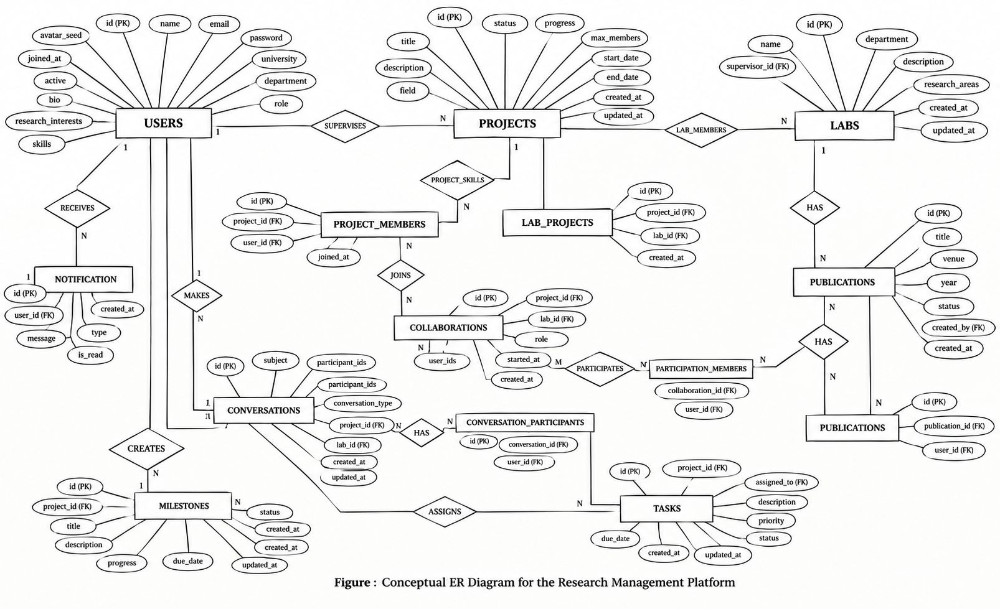
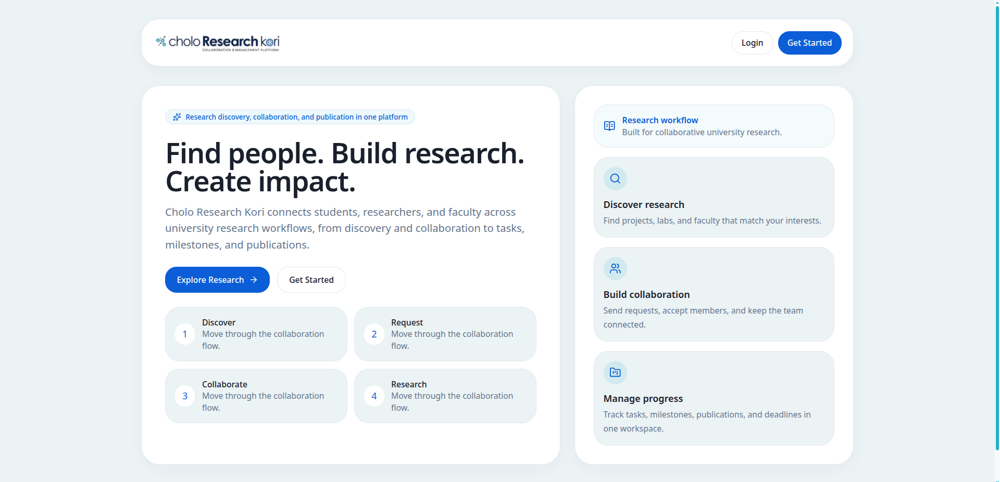
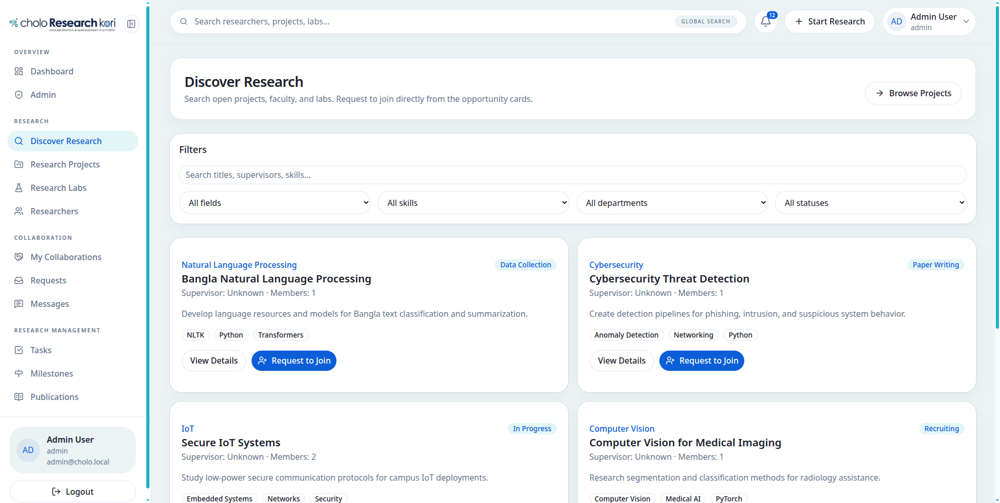
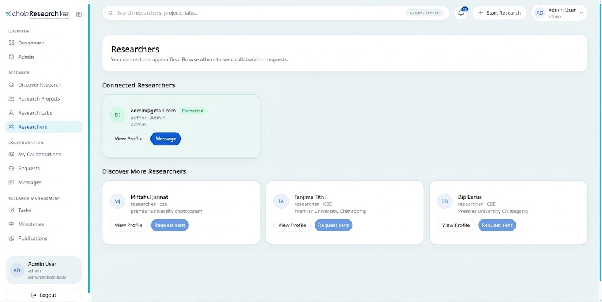
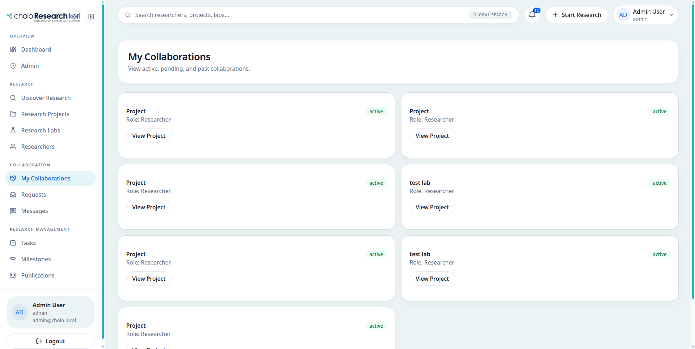
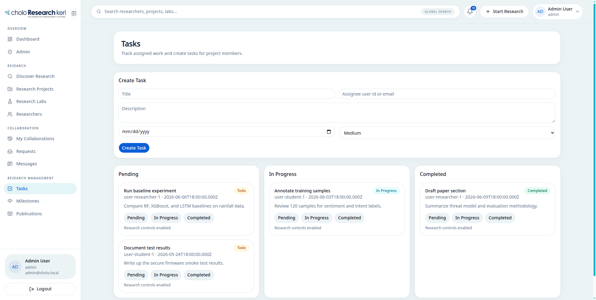
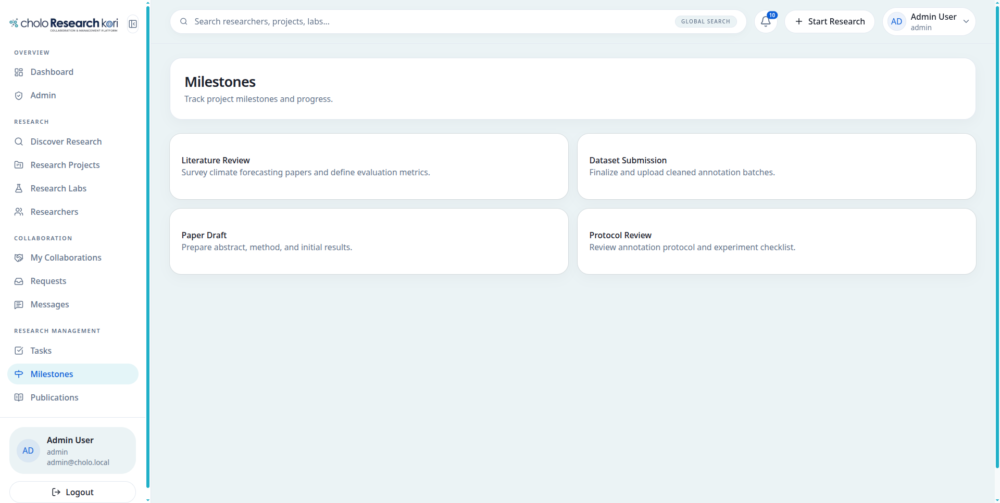
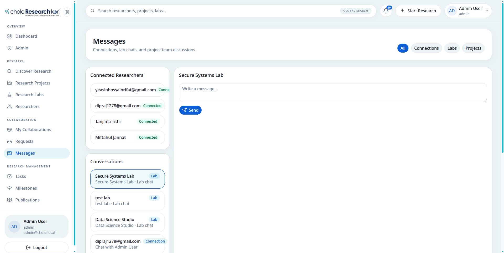
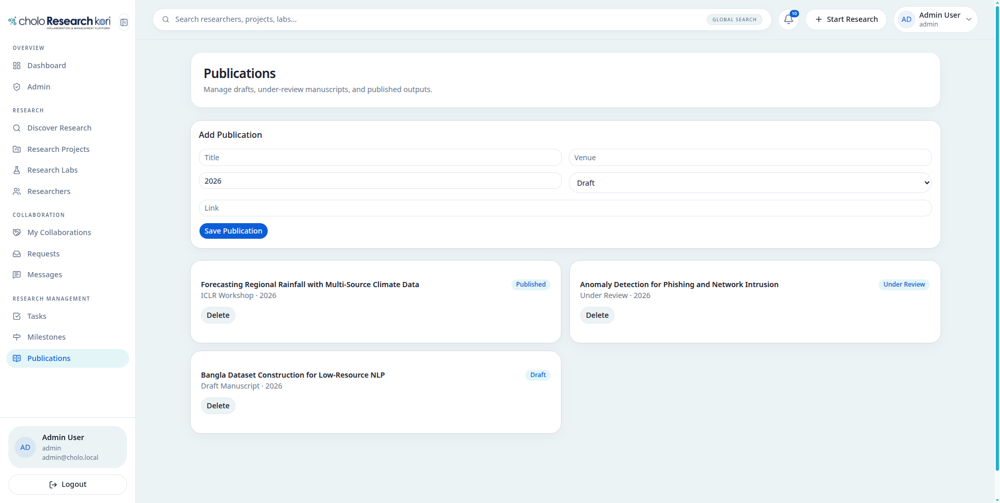

# Cholo Research Kori

Cholo Research Kori is a DBMS-based research collaboration platform designed for researchers, supervisors, and academic users. The project supports research project discovery, collaboration management, messaging, notifications, task tracking, publication records, and profile-based coordination in a single system.

## Project Objective

The goal of this project is to design and implement a structured relational database application that allows users to collaborate on research activities while maintaining data consistency, normalization, and efficient data management across multiple system modules.

## Tech Stack

- Frontend: Next.js
- Language: JavaScript / React
- Backend: Next.js API Routes
- Database: MySQL
- Styling: Tailwind CSS
- Runtime: Node.js
- Package Manager: npm
- Container Support: Docker / Docker Compose

## Core Modules

- User / Researcher Panel
- Supervisor / Faculty Panel
- Research Project Panel
- Collaboration Panel
- Messaging Panel
- Notification Panel
- Profile / Settings Panel
- Database Management Layer

## Key Features

- Researcher registration and login
- Academic profile and skill management
- Research project creation and tracking
- Collaboration request workflow
- Search and discovery of projects and researchers
- Communication through messages and notifications
- Task and milestone tracking
- Publication and project visibility
- Dashboard-based overview of active research work

## Project Structure

- Application source: `src/`
- API routes: `src/app/api/`
- UI components: `src/components/`
- Project documentation: `DOCS/`
- ER diagram: `DOCS/Er_Diagram.png`
- Screenshots: `DOCS/Screenshots/`
- Report file: `DOCS/DBMS Project report.pdf`

## Documentation and Assets

- [Project Report PDF](DOCS/DBMS%20Project%20report.pdf)
- [Screenshots Folder](DOCS/Screenshots)

## ER Diagram



The ER diagram represents the core database entities and relationships for users, projects, labs, collaborations, tasks, milestones, notifications, publications, and messaging modules.

## Screenshot Gallery

### Landing Page


### Dashboard


### Research Discovery


### Researchers


### My Collaborations


### Tasks


### Milestones


### Messages


### Publications


## Team Members

- [Dip Barua](https://github.com/dip-barua)
- [Miftahul Jannat Mim](https://github.com/MmiFTahM)
- [Tanjima Ahmed Chowdhury Tithi](https://github.com/tanjimatithi)

## Setup and Run Instructions

### 1. Clone the repository

```bash
git clone <repository-url>
cd cholo-research-kori
```

### 2. Install dependencies

```bash
npm install
```

### 3. Start the application

```bash
npm run dev
```

### 4. Open the app

Open the browser at:

```text
http://localhost:3000
```

### 5. Optional: run with Docker

```bash
docker-compose up --build
```

## Notes

This project is implemented as a modern web-based DBMS application using a structured relational design and modular application flow. All supporting documentation, screenshots, and schema assets are preserved in the `DOCS` directory for review, reporting, and demonstration purposes.
